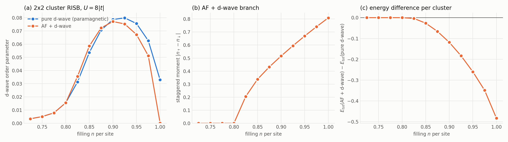

# E4 — d-wave superconductivity in the 2x2 cluster Hubbard model

`Square_2x2_dwave_sc.py` computes the d-wave superconducting order parameter
of the doped Hubbard model on the square lattice. It uses a 2x2 cluster
fragment at B = 1 (cluster RISB), with U = 8|t|, at fillings from n = 2.9 to
4.0 electrons per cluster. Two solutions are followed: the pure d-wave
superconductor (paramagnetic), and Neel antiferromagnetism coexisting with
d-wave superconductivity (AF + d-wave), which is lower in energy near half
filling. The example shows the three ingredients of a superconducting
calculation in GEM:

* the Nambu basis of `gem.nambu`;
* the non-magnetic projection `Fragment.impose_nambu_spin_symmetry`;
* DIIS extrapolation (`gem.diis`).



## Running

```bash
PYTHONPATH=/path/to/gem/python python3 Square_2x2_dwave_sc.py
python3 plot_dwave.py
```

The script computes the pure d-wave branch (`paramagnetic = True`). Set
`paramagnetic = False` and run it again for the AF + d-wave branch.

Each scan takes about 5 minutes on a laptop: about 30 iterations at the first
filling and about 10 at each of the others. The embedding problem has 16
levels, and the S_z = 0 sector has 12870 states. Results go to
`data_Square_2x2_dwave_U8.0.h5` (pure d-wave) or
`data_Square_2x2_dwave_U8.0_afm.h5` (AF + d-wave), with one group `n<n>` per
filling holding:

| dataset | meaning |
|---|---|
| `mu` | chemical potential |
| `Z` | (R^dag R)_00, quasiparticle weight of site 0, spin up |
| `dwave` | abs d-wave order parameter (see below) |
| `mag` | largest local moment abs(n_up - n_dn), zero for the paramagnetic solution |
| `Ekin`, `Epot`, `Etot` | kinetic, interaction and total energy per cluster, without -mu N |
| `R`, `Lambda`, `denMat` | converged parameters and impurity density matrix, in the Nambu basis |

`plot_dwave.py` reads whichever of the two files are present and writes
`figE4.png`, the figure above. Panel (a) shows the d-wave order parameter of
both branches, panel (b) the staggered moment of the AF + d-wave branch, and
panel (c) the energy difference between the two branches,
Etot(AF + d-wave) - Etot(pure d-wave).

## Model

The 2x2 supercell has sites 0 (0,0), 1 (1,0), 2 (0,1) and 3 (1,1), and nearest-neighbour
hopping t = -1. The cluster dispersion e_ij(K) = sum_R t_ij(R) exp(iK.R)
is built on a 37x37 grid of the supercell Brillouin zone. Its K average,
the intra-cluster hopping, is moved to the local Hamiltonian `eloc`. The
interaction is U n_up n_dn on every site.

A small d-wave pairing field (`field = 1e-3`) on the x bonds (+) and the
y bonds (-) selects the symmetry of the order parameter:

    Delta_ij (c^dag_{i,up} c^dag_{j,dn} - c^dag_{i,dn} c^dag_{j,up}) + h.c.,
    Delta_ij = +-field/sqrt(2)

The order parameter is computed from the anomalous amplitudes
F_ij = <c^dag_{i,up} c^dag_{j,dn}> as sum_<ij> (+-) F_ij / (4 sqrt 2).

## How superconductivity is treated

GEM solves particle-number conserving problems. Singlet pairing is brought
to that form by the particle-hole transformation of the spin-down orbitals,
c_{k,dn} -> d^dag_{-k,dn} (`gem.nambu`):

| physical | Nambu basis |
|---|---|
| hopping, spin up | unchanged |
| hopping, spin down | hole block -e_dn(k) (real hoppings) |
| pairing Delta c^dag_up c^dag_dn | hybridization Delta c^dag_up d |
| U n_up n_dn | -U n_up n_d + U n_up |
| -mu N | -mu tau_3 + const |
| conserved N | physical S_z |

`Lattice`, `Fragment` and `SimpleED` are then used unchanged:

```python
eks_n, _ = nambu_one_body(eks)                                   # lattice
eloc_n, U_n, e0 = nambu_local(eloc, Utensor, pairing=Delta)      # local part
solver = SimpleED(ntot, use_Ntot=True, N_sector=ntot//2)         # S_z = 0, no use_Sz
fragment = Fragment(nimp, nbath, eloc_n, U_n, solver, nambu=True)
```

* With `nambu=True` the chemical potential couples to tau_3, and
  `fragment.nfill` is the physical filling. The filling is fixed with
  `lattice.fit_mu(..., mode='fragment')`. The quasiparticle mode counts the
  transformed particles, i.e. S_z, and raises an error for a Nambu fragment.
* `nambu_density_matrix(fragment.denMat[:nimp, :nimp])` returns the physical
  rho_up, rho_dn and F.
* Since -mu N and the interaction have been rewritten, the physical local
  energy is
  `fragment.compute_energy() + mu*np.dot(fragment.charge, np.diag(dm)) + e0`.

Only singlet (opposite-spin) pairing can be represented. Spin-flip terms and
equal-spin pairing raise a `ValueError`.

## Self-consistency loop

```python
for it in range(itmax):
    lattice.solve_qp([fragment], T=0.0, Tsmearing=Tsmearing)
    fragment.update_hybridization(T=0.0)
    fragment.impose_nambu_spin_symmetry()
    mu = lattice.fit_mu(n_target, [fragment], T=0.0, mu_old=mu, mode='fragment')
    fragment.update_self_energy(T=0.0)
    fragment.impose_nambu_spin_symmetry()
    R_out, Lambda_out = hermitian_gauge(fragment.R, fragment.Lambda)
    diis.append([R_out, Lambda_out] - [R_in, Lambda_in], [R_out, Lambda_out])
    fragment.R, fragment.Lambda = diis.solve()
```

(The `append` line is schematic: the script stacks the pairs into arrays.)

**Seed.** At the first filling (n = 3.6) the loop starts with 20 plain mixing
iterations under a larger pairing field (`seed_field = 0.05`). For the
AF + d-wave branch a staggered field `seed_stagger = 0.1` on the
checkerboard (+ on sites 0 and 3, - on sites 1 and 2) is added to the seed.
Every later filling starts from the previous solution. The scan runs in two
sweeps from n = 3.6, one up to half filling and one down to n = 2.9.

**Paramagnetic projection.** `impose_nambu_spin_symmetry` is the Nambu
counterpart of `impose_spin_SU2_symmetry`. A pi spin rotation acts on the
Nambu spinor as psi -> K psi^dag, with K = diag([[0,1],[-1,0]], ...). The
projection keeps the invariant parameters, R = K^T R^* K, D = K^T D^* K,
Lambda = -K^T Lambda^T K and Lambda_c = -K^T Lambda_c^T K, which removes
S_z magnetization and keeps singlet pairing. With `paramagnetic = False` it
is not applied, and the loop finds the AF + d-wave solution (see
[Results](#results)).

**DIIS.** The paramagnetic d-wave solution is an unstable fixed point of the
plain mixing loop for n <~ 3.4. Linear mixing leaves it: the deviation grows
by about 1.5 per iteration. It then stalls on a state that is not a solution:
mu and the order parameter freeze, but the residual stays at about 0.1. DIIS
(Pulay) extrapolation over the last 8 iterates converges to it in about 10
iterations. DIIS combines R and Lambda from different iterations, which is
only meaningful in a fixed bath gauge (R -> U R, Lambda -> U Lambda U^dag).
The script uses the gauge in which R is Hermitian (polar decomposition, B = 1),
which also preserves the spin structure that the projection relies on.

## Results

### Pure d-wave branch (`paramagnetic = True`)

| n per cluster | n per site | mu | Z | d-wave | Etot |
|---|---|---|---|---|---|
| 2.9 | 0.725 | 1.1995 | 0.7519 | 0.0034 | -3.7921 |
| 3.0 | 0.750 | 1.3851 | 0.7333 | 0.0051 | -3.6634 |
| 3.1 | 0.775 | 1.5576 | 0.7135 | 0.0079 | -3.5160 |
| 3.2 | 0.800 | 1.7357 | 0.6919 | 0.0155 | -3.3515 |
| 3.3 | 0.825 | 1.9169 | 0.6687 | 0.0313 | -3.1686 |
| 3.4 | 0.850 | 2.0532 | 0.6441 | 0.0536 | -2.9698 |
| 3.5 | 0.875 | 2.1572 | 0.6222 | 0.0706 | -2.7591 |
| 3.6 | 0.900 | 2.2486 | 0.6088 | 0.0786 | -2.5391 |
| 3.7 | 0.925 | 2.3513 | 0.6043 | 0.0799 | -2.3091 |
| 3.8 | 0.950 | 2.4534 | 0.6141 | 0.0756 | -2.0689 |
| 3.9 | 0.975 | 2.5901 | 0.6400 | 0.0626 | -1.8176 |
| 4.0 | 1.000 | 4.0000 | 0.6587 | 0.0329 | -1.5229 |

The order parameter forms a dome with its maximum near n = 0.92 per site,
and it stays finite (0.033) at half filling. All points converge to a
residual below 1e-7 with zero local moment.

### AF + d-wave branch (`paramagnetic = False`)

Dropping the paramagnetic constraint lets the Neel order of the half-filled
Mott insulator develop. Energies are compared with the pure d-wave branch at
the same filling, dE = Etot(AF + d-wave) - Etot(pure d-wave):

| n per site | staggered moment | d-wave | Etot | mu | dE |
|---|---|---|---|---|---|
| 0.725 | 0 | 0.0034 | -3.7921 | 1.1995 | 0 |
| 0.750 | 0 | 0.0051 | -3.6634 | 1.3851 | 0 |
| 0.775 | 0 | 0.0079 | -3.5160 | 1.5576 | 0 |
| 0.800 | 0 | 0.0155 | -3.3515 | 1.7357 | 0 |
| 0.825 | 0.205 | 0.0356 | -3.1724 | 1.7880 | -0.0038 |
| 0.850 | 0.337 | 0.0585 | -2.9962 | 1.7327 | -0.0264 |
| 0.875 | 0.432 | 0.0723 | -2.8252 | 1.6907 | -0.0660 |
| 0.900 | 0.516 | 0.0771 | -2.6576 | 1.6623 | -0.1185 |
| 0.925 | 0.594 | 0.0753 | -2.4924 | 1.6428 | -0.1833 |
| 0.950 | 0.669 | 0.0672 | -2.3289 | 1.6274 | -0.2600 |
| 0.975 | 0.741 | 0.0511 | -2.1669 | 1.6131 | -0.3493 |
| 1.000 | 0.808 | 0.0002 | -2.0062 | 3.9955 | -0.4832 |

Compared with the pure d-wave branch:

* **Onset of antiferromagnetism.** For n <= 0.80 per site the two branches
  are the same solution. The staggered moment appears between n = 0.80 and
  0.825, then grows steadily to 0.81 at half filling.
* **Coexistence.** For 0.825 <= n < 1 antiferromagnetism and d-wave
  superconductivity coexist. Wherever the moment is finite, the AF + d-wave
  state is lower in energy. The gain grows from 0.004 at n = 0.825 to 0.48 at
  half filling.
* **Superconductivity is suppressed near half filling.** At low moment the
  d-wave order is slightly enhanced (0.0585 against 0.0536 at n = 0.85). The
  dome then peaks lower and earlier (0.077 at n = 0.90, against 0.080 at
  0.925), and the order falls quickly as the moment grows. At half filling
  the solution is a pure Neel insulator: the d-wave value of 2e-4 is just the
  response to the 1e-3 pairing field. The finite d-wave order of the pure
  d-wave branch at half filling is therefore an artefact of the paramagnetic
  constraint.
* **Negative compressibility.** On the AF + d-wave branch mu decreases as n
  increases, from 1.788 at n = 0.825 to 1.613 at n = 0.975. A uniform state
  with dn/dmu < 0 is thermodynamically unstable. The doped AF + d-wave state
  is therefore expected to phase-separate into the half-filled Neel insulator
  and a more strongly doped phase; a Maxwell construction on Etot(n) would
  locate the two coexisting fillings. At half filling mu jumps into the Mott
  gap: any mu inside the gap gives n = 1, so the value 3.9955 is only one
  point of that range.

## Tests

`test/python/test_nambu.py` and `test/python/test_diis.py` (run by
`make test`) check the pieces this example relies on:

| test | what it checks |
|---|---|
| `test_spectrum_kanamori` | Brute-force Jordan-Wigner check in the full Fock space: H_loc with complex hopping, Kanamori U, J and a random singlet pairing field has the same spectrum as its Nambu transform plus `e0`. |
| `test_hubbard` | U n_up n_dn maps to -U n_up n_d + U n_up. |
| `test_dispersion_hole_block` | The hole block of a k-resolved dispersion is -e_dn(k), and the constant is Tr e_dn(k). |
| `test_refuse_sz_breaking` | Spin-flip hopping and S_z-breaking interactions raise `ValueError`. |
| `test_fragment_options` | `nambu=True` sets the tau_3 charge, refuses `impose_spin_SU2_symmetry` and the quasiparticle `fit_mu`. |
| `test_bcs_noninteracting` | End to end: square lattice, U = 0, local s-wave field, T > 0, filling fitted with `fit_mu(mode='fragment')`. RISB is exact here, so the converged fragment must reproduce the BdG k-sum for F, n and rho_up = rho_dn, and be invariant under `impose_nambu_spin_symmetry`. |
| `test_nambu_spin_projector` | `impose_nambu_spin_symmetry` is idempotent, keeps Lambda Hermitian and removes the uniform magnetization term from Lambda. |
| `test_mixing_diverges` / `test_unstable_fixed_point` | On a linear map with an eigenvalue 1.5, linear mixing diverges while DIIS converges to the fixed point. |
| `test_coefficients_and_history` | DIIS coefficients are real and sum to one, so Hermitian states stay Hermitian; the history is capped at `nvec`. |

Run them alone with

```bash
PYTHONPATH=python python3 test/python/test_nambu.py
PYTHONPATH=python python3 test/python/test_diis.py
```
